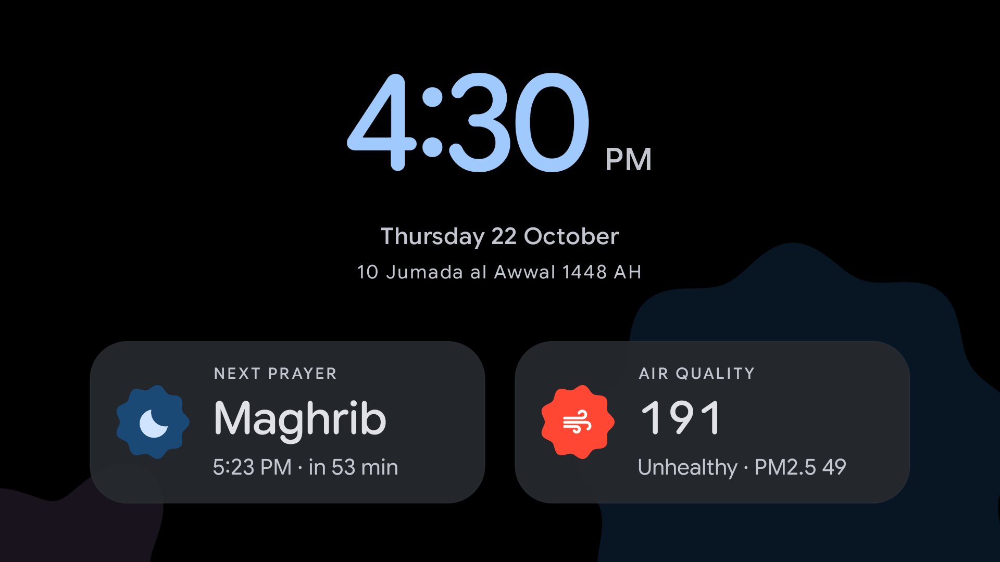

<h1 align="center">freeTV · Pakistan edition</h1>

<p align="center"><b>A cleaner, smarter Android TV for Pakistani homes. No root.</b><br>
A fork of <a href="https://github.com/kienmai160598/freeTV">kienmai160598/freeTV</a>, which is built on
<a href="https://github.com/Gathin23/cleanyourtv">Gathin23/cleanyourtv</a>, set up for Lahore and the rest of Pakistan.</p>

<p align="center">
  <a href="#install">Install</a>&nbsp;&nbsp;&nbsp;&nbsp;
  <a href="../../releases/latest">Download</a>&nbsp;&nbsp;&nbsp;&nbsp;
  <a href="#after-a-firmware-update-no-computer-needed">After an update</a>&nbsp;&nbsp;&nbsp;&nbsp;
  <a href="#undo">Undo</a>
</p>

<p align="center">
  
</p>

## What it adds for Pakistan

- **Weather and air quality** for Lahore by default, with Karachi, Islamabad, Rawalpindi, Faisalabad, Multan,
  Peshawar and Quetta a click away (hold OK on the weather card > Settings > Location). Air quality is the
  US AQI, with its band colour, so a smoggy day shows red.
- **Hijri date as Pakistan keeps it**: Umm al-Qura moved one day for Ruet-e-Hilal's moon sighting (adjustable on
  the card if they ever disagree), counting down to Pakistan's days: Kashmir Day, Pakistan Day, Labour Day,
  Youm-e-Takbeer, Independence Day, Iqbal Day, Quaid-e-Azam Day, Ramazan, Eid ul Fitr, Eid ul Adha, Islamic New
  Year, Ashura, Eid Milad-un-Nabi and Shab-e-Barat.
- **Prayer times** worked out on the TV with no internet: University of Islamic Sciences, Karachi (Fajr and Isha
  at 18 degrees) with Hanafi Asr, or the standard Asr in the card's Settings, for the weather card's city.
  They match published Lahore timetables to the minute or so; your mosque may add a few minutes.
- **Prayer reminders**: at each prayer's time a banner slides in at the top of the screen over whatever is
  playing ("It's time for Asr prayer"), without pausing it, and fades after 30 seconds. Optionally ten
  minutes before as well, or off.
- **A screensaver made to read from across the room**: the clock, the Gregorian and Hijri dates, the next prayer
  with a countdown and the air quality; the song too while music plays.
- **Now playing**: Spotify, YouTube Music or AirPlay audio playing in the background brings up a bar on Home with
  the album art, play/pause, and a cross that stops the music and slides the bar away.
- **Control Center** (the sliders button left of Inputs, and the remote's gear button on TCL): sleep timer, turn
  off now, free memory, screensaver now, AirPlay, TV check, and the TV's settings.
- **TV check**: after a firmware update, shows what it undid and fixes it with the remote (see below).
- **Light or dark**: dark from 6 PM to 6 AM by default, or always light, or always dark.
- **Smooth on cheap TVs**: the background shapes stay still (Advanced effects moves them), a thin focus ring, five
  apps per row: YouTube, ARY Plus, Netflix, Prime Video and Apple TV in the dock (missing apps are skipped).
- **TCL Google TV fixes**, tested on a TCL Smart TV Pro (G03, Android 11): the remote-button helper survives a
  restart (it is direct-boot aware and gets TCL's `APP_AUTO_START`), Home never jumps over an app opened right
  after boot, and TCL's YouTube, Netflix, Prime Video and gear buttons are mapped.

The rest is freeTV's: Material 3 Expressive home, widgets, Edit Home, the debloat lists for 108 TVs and the
`tvctl` tool. This build does not update itself from freeTV's releases: it is signed with its own key.

## Install

You need a computer once, with [Android platform-tools](https://developer.android.com/tools/releases/platform-tools)
(`adb`). After that the TV needs no computer.

1. On the TV: Settings > System (or Device Preferences) > About, press **Build** seven times. Then in
   Developer options switch on **USB debugging** (and **Network debugging** if it is there). Note the TV's IP
   address (Settings > Network).
2. Download `km-launcher-pk.apk` from [Releases](../../releases/latest), or build it (below), then on the
   computer:

   ```bash
   adb connect <tv ip>:5555            # on the TV: tick "Always allow" and press OK
   adb install -r km-launcher-pk.apk
   adb shell cmd package set-home-activity com.gathin.tvhome/.MainActivity
   adb shell settings put secure enabled_accessibility_services com.gathin.tvhome/.HomeKeyService
   adb shell settings put secure accessibility_enabled 1
   adb shell appops set com.gathin.tvhome APP_AUTO_START allow   # TCL; other TVs answer "unknown", that is fine
   adb shell appops write-settings
   adb shell cmd notification allow_listener com.gathin.tvhome/com.gathin.tvhome.NowPlayingListener
   adb shell pm grant com.gathin.tvhome android.permission.ACCESS_FINE_LOCATION
   adb shell pm grant com.gathin.tvhome android.permission.WRITE_SECURE_SETTINGS
   ```

   Press Home on the remote. If the TV asks which home to use, pick this one, Always.
3. Optional, to remove ads and tracking: debloat with your TV's list in [`packages/debloat-lists/`](packages/debloat-lists/)
   using `tvctl` (freeTV's steps in [`docs/prompt.md`](docs/prompt.md)), or let a coding agent follow that prompt.
   Switch off the stock Google TV home only after this one shows on Home.
4. Close debugging when you are done: Developer options > **Revoke USB debugging authorisations**, USB debugging
   off, Network debugging off, then restart the TV. Nothing here needs debugging to run.

For iPhone screen mirroring, the open-source [AirPlay receiver](https://github.com/jqssun/android-airplay-server)
(a separate GPL-3 app) shows up in Control Center once installed: open it, then mirror from the iPhone.

## After a firmware update (no computer needed)

Everything lives on the TV: a firmware update cannot break it, and nothing here was rooted, flashed or
uninstalled. An update may switch some things back. Open Control Center > **TV check**:

- **Make this the Home app**: an update brought Google TV's home back. OK opens the Home app picker; pick this
  launcher. (If Google TV's home is showing, open this launcher from its apps row first.)
- **Turn on remote buttons**: the helper behind the YouTube, Netflix, Prime Video and gear buttons was switched
  off. OK opens Accessibility; switch **Home button** on.
- **Music bar needs a PC**: only the now playing bar needs the `allow_listener` line above again. Everything
  else keeps working.

Disabled apps (ads, tracking) that an update switches back on are harmless; switch them off again in
Settings > Apps, or with a computer and your list.

## Undo

- Settings > Apps > See all apps > this launcher (km-launcher) > Uninstall, then Settings > Apps > Show system
  apps > Google TV Home > Enable.
- Or a factory reset, which puts the TV back exactly as it came.

## Build

JDK 17 and Android SDK 34:

```bash
cd apps/launcher
./gradlew testReleaseUnitTest assembleRelease   # app/build/outputs/apk/release/km-launcher.apk
```

Without your own key in `KM_KEYSTORE` (and `KM_KEYSTORE_PASSWORD`, `KM_KEY_ALIAS`, `KM_KEY_PASSWORD`) the APK
is signed with Android's debug key. Keep using the same key: Android installs a new build over an old one only
when both are signed with it.

## Credits

- MIT licence. [freeTV](https://github.com/kienmai160598/freeTV) by kienmai160598, forked from
  [CleanYourTV](https://github.com/Gathin23/cleanyourtv) by Gathin23, whose contributors wrote the debloat lists.
- The sleep timer and turn off follow samdegan2311's
  [Control Center](https://github.com/samdegan2311/tv-vibehack/tree/pr/control-center).
- Weather and air quality: [Open-Meteo](https://open-meteo.com). Prayer times: the Astronomical Almanac's sun
  formulas with the Karachi method's angles.
- Google Sans Flex: SIL Open Font License. Material Color Utilities: Apache 2.0.
